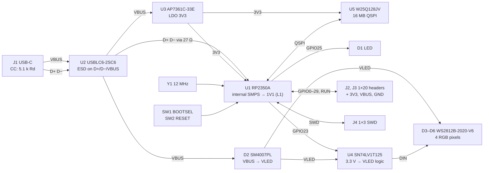

# Architecture: easy2350

Phase 1. Each block below is one region of the schematic and one region of the
placement. Part audits are in `parts/`, one file per block.

## Blocks

| Block | Parts | Audit |
|---|---|---|
| USB front end | J1, CC resistors, U2, 27 Ω series pair | `parts/usb-front-end.md` |
| 3V3 regulator | U3, its input and output capacitors | `parts/ldo-3v3.md` |
| RP2350 core | U1, L1 and the regulator passives, decoupling, Y1 and its load, BOOTSEL/RUN | `parts/rp2350-core.md` |
| Flash | U5 and its decoupler | `parts/flash.md` |
| RGB LEDs | D2, U4, D3–D6 and their decouplers | `parts/rgb-leds.md` |
| User I/O | SW1, SW2, D1 and its resistor, J2–J4, test points | `parts/user-io.md` |

## Signal and power paths

- **VBUS** (4.5–5.5 V at J1) feeds three loads: the LDO, the LED rail through
  D2, and header pin VBUS. The USB 2.0 attach limit caps everything on VBUS at
  10 µF.
- **3V3** feeds the RP2350 (IOVDD, VREG_VIN, VREG_AVDD through its RC,
  ADC_AVDD, USB_OTP_VDD, QSPI_IOVDD), the flash, D1, and header pin 3V3.
- **1V1** is made inside the RP2350 and only goes to its DVDD pins. It never
  leaves the chip's corner of the board.
- **VLED** is VBUS less a Schottky drop. It only feeds U4 and the four pixels.
- **USB D+/D−**: J1 → U2 (in-line) → 27 Ω at U1 → U1.
- **QSPI**: U1 ↔ U5, six lines, short and away from VREG_LX.
- **GPIO**: every GPIO goes straight to the headers. GPIO25 also drives D1;
  GPIO23 also drives U4's input. Either still works as a header GPIO, with the
  LED or pixel chain responding.
